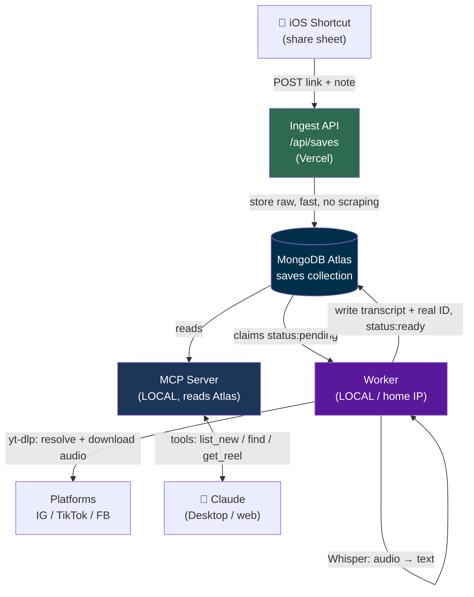
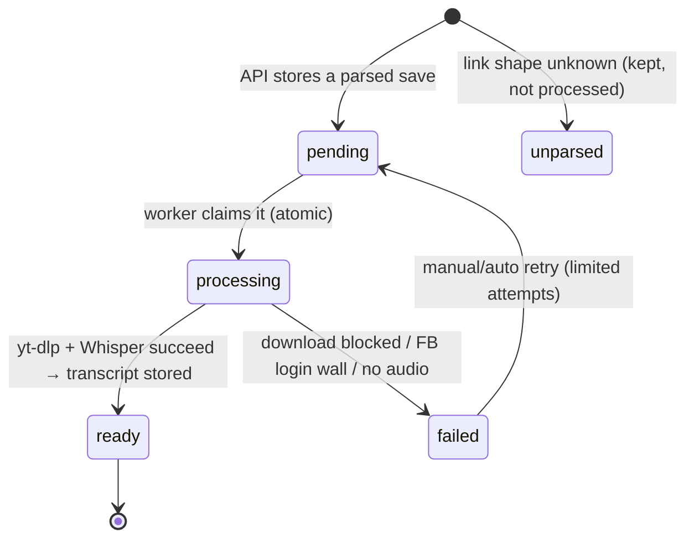
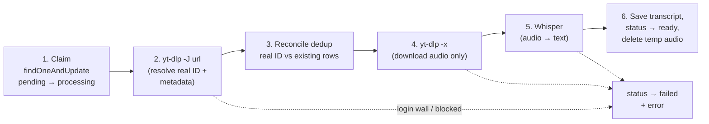
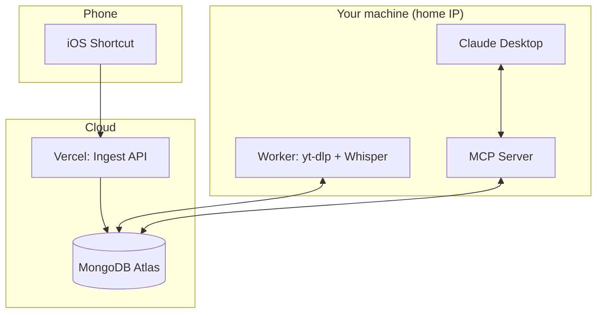

# Reel Saves — End-to-End Architecture

A living reference for the whole system: capture → store → resolve+transcribe → surface in Claude.
Phase 1 (ingest) is built. Phases 2–3 are the plan.

---

## 1. The vision

You consume a lot of short-form video (Instagram / TikTok / Facebook). Some of it is genuinely
useful — hooks, ideas, techniques. Today that value is trapped in a video you'll never scroll back to.

Reel Saves turns it into an **AI-queryable knowledge base**: one-tap capture → background
transcription → and when you open Claude to work, it proactively tells you *"you have 3 new reels,
one relates to this project — want to add it?"*

The end payoff: **the reel becomes text your AI can reason over while you work.**

---

## 2. The big picture



**Golden rule that answers the "will we get banned?" question:** only the **Worker** ever contacts
the platforms, and it runs **locally on your home (residential) IP** — which the platforms block
far less than datacenter IPs. The API and MCP server never touch IG/TikTok/FB at all.

---

## 3. Components

| Component | Where it runs | Talks to platforms? | Ban risk | Status |
|---|---|---|---|---|
| **iOS Shortcut** | Your phone | No | none | ✅ working |
| **Ingest API** (`/api/saves`) | Vercel (serverless) | No — only stores | **none** | ✅ built (deploy pending) |
| **MongoDB Atlas** | Cloud (M0 free) | No | none | pending |
| **Worker** (resolve + transcribe) | **Local machine** | Yes — yt-dlp + audio download | low (home IP, low volume) | phase 2 |
| **MCP Server** | **Local** (Claude connects) | No — reads Atlas | none | phase 3 |

Atlas is the **shared hand-off**: the API writes rows; the worker and MCP server read/update them.
This decoupling is what lets the API live in the cloud while the risky worker stays home.

---

## 4. Data lifecycle (the status state machine)



- `status` is the transcription hook. `resolved` (boolean) is the *separate* hook meaning
  "the real ID/URL is known" — Instagram is `resolved:true` at ingest; TikTok/Facebook become
  `resolved:true` once yt-dlp follows the redirect.
- `read` (boolean) drives the MCP "new / unread" experience.

---

## 5. Schema evolution

**Phase 1 (built, multi-tenant) — already stores everything the pipeline needs to start:**

```
owner, platform, contentId, dedupKey, resolved, url, rawUrl,
note, source, capturedAt, status, read, transcript
```

Every save carries an **`owner`** (from the user's API key). The unique index is compound
`{owner, dedupKey}` and *partial* (only where `dedupKey` is a string), so each user dedups
within their own reels and unparsed rows never collide. See `README.md` for the multi-tenant
auth model (`API_KEYS` = `owner:key` pairs).

**Phase 2 adds (filled by the worker, mostly free from yt-dlp's metadata):**

```
title            // video title / caption
uploader         // @handle / page
durationSec      // length
thumbnailUrl     // preview image
transcript       // ← the whole point: the text
transcriptLang   // detected language (e.g. "en", "ar")
segments         // optional: [{start, end, text}] for timestamped quotes
error            // failure reason when status:"failed"
attempts         // retry counter
processedAt      // when transcription finished
```

**Phase 3 (optional, for smart relevance):**

```
embedding        // vector of the transcript for Atlas Vector Search
readAt           // when surfaced/added in Claude
```

No re-architecture needed — every later field is additive.

---

## 6. The Worker in detail (phase 2)

The worker is a small loop that runs on your machine. Per cycle:



**Why yt-dlp does steps 2 & 4:** given a short link (`vt.tiktok.com/…`, `facebook.com/share/r/…`),
`yt-dlp --dump-json <url>` follows the redirect and returns JSON with the **real numeric id**,
canonical `webpage_url`, `title`, `uploader`, `duration`, `thumbnail`. That *is* our resolver — no
manual HTTP redirect handling. Then `yt-dlp -x --audio-format mp3` pulls **audio only** (lighter than
video, and all Whisper needs). yt-dlp supports Instagram, TikTok, and Facebook and is community-
maintained against site changes.

**Reconcile (step 3):** once the real TikTok/FB id is known, update `contentId`/`dedupKey` to
`platform:<realid>` and `resolved:true`. If another row already has that real id (same video shared
twice via different share codes), merge — keep one, drop the duplicate.

**Language: Node or Python?** The rest of the stack is Node. Two clean options:
- **Node worker that shells out** to the `yt-dlp` binary and a Whisper CLI (`whisper.cpp` or
  `faster-whisper`). One codebase language, binaries do the heavy lifting. ← recommended.
- **Python worker** — natural fit since yt-dlp and faster-whisper are Python libraries.

---

## 7. Transcription deep dive — Whisper

**What it is:** [Whisper](https://github.com/openai/whisper) is OpenAI's open-source speech-to-text
model — **MIT-licensed, free, runs entirely on your machine, no API cost, no per-minute billing.**
It handles 90+ languages and is robust to accents, background music, and noise (exactly the reel case).

### Which Whisper flavor to run locally

| Flavor | What it is | Best when |
|---|---|---|
| `openai-whisper` | Original Python/PyTorch reference | GPU available, want the canonical impl |
| **`faster-whisper`** | CTranslate2 reimpl — ~4× faster, less RAM, int8 CPU mode | **Recommended default** (fast on CPU) |
| `whisper.cpp` | C/C++ port, single binary, no Python | Windows/Mac with no GPU, want zero deps |

For this project (Windows, short clips, no guaranteed GPU): **`faster-whisper` with `int8` on CPU**,
or **`whisper.cpp`** if you'd rather call a standalone binary from the Node worker.

### Model sizes (accuracy vs speed vs disk)

| Model | Params | Download | Rel. speed | Accuracy | Notes |
|---|---|---|---|---|---|
| tiny | 39M | ~75 MB | ~10× | low | quick smoke tests |
| base | 74M | ~145 MB | ~7× | ok | fast rough drafts |
| **small** | 244M | ~460 MB | ~4× | good | **recommended starting point** |
| medium | 769M | ~1.5 GB | ~2× | better | bump to this if transcripts are rough |
| large-v3 | 1.5B | ~3 GB | 1× | best | hardest audio / heavy accents |

(Speeds are relative to `large`; approximate.) Reels are short (15–90 s), so even `medium` finishes
in seconds-to-tens-of-seconds on CPU. Start at **`small`**, move to `medium` only if quality demands.

### CPU vs GPU
GPU (CUDA) is much faster, but because reels are short and this runs in the background, **CPU is
perfectly fine.** No GPU purchase needed to ship this.

### Language handling (important for you)
Whisper **auto-detects** the language and transcribes in the original — so Arabic/French/English
reels all work. It can also **translate to English** (`task=translate`) if you'd prefer every
transcript in English for uniform searching. We can store `transcriptLang` and decide per-reel.

### Input / output
- **Input:** audio only (mp3/wav/m4a from yt-dlp). Whisper internally resamples to 16 kHz mono.
- **Output:** plain text, and optionally **timestamped segments** — useful later for "at 0:42 they
  say…" citations inside Claude.

### The free-vs-hosted tradeoff
- **Local Whisper (chosen):** free forever, private (audio never leaves your machine), one-time model
  download, uses your CPU/GPU.
- **Hosted fallback (optional, not now):** OpenAI Whisper API (~$0.006/min) or Groq's very cheap/fast
  Whisper — zero local compute, tiny cost, but sends audio to a third party. Keep in back pocket only
  if local proves too slow.

---

## 8. Avoiding bans / blocks (the concern, addressed)

- **All platform contact lives in the local worker** on your **residential IP** — the single biggest
  factor. Datacenter IPs (Vercel/AWS) get fingerprinted and rate-limited aggressively; home IPs read
  as normal users. This is *why* the worker never goes on Vercel.
- **Low volume + politeness:** process sequentially (not in parallel), add a small random delay
  between jobs, keep yt-dlp updated.
- **Audio-only** downloads are lighter and less scraper-like than full video.
- **Facebook login/checkpoint wall** → treat as `status:"failed"` with the reason; don't retry-hammer.
  (For private/age-gated content, yt-dlp can use exported browser cookies — add only if needed.)
- The **ingest API carries zero risk** — it never contacts the platforms — so deploying it publicly is
  completely safe.

---

## 9. The MCP layer & the "proactive greeting" (phase 3)

The MCP server exposes **tools** Claude can call:

- `list_new_reels` — unread saves (uses the `read` flag)
- `find_reels(topic)` — reels matching a subject / project
- `get_reel(id)` — pull a full transcript into the conversation
- `mark_read(id)` — so it stops resurfacing

**The honest caveat:** MCP is **pull-based** — the server can't *push* a message into your chat. You
get the proactive feel via a **one-time instruction in your Claude Project**, e.g.:

> *"At the start of each conversation, call `list_new_reels`. If any relate to this project, tell me
> how many and which, and ask if I want to add them."*

Then Claude greets you exactly that way every session, using the project's topic as the query.

**Relevance — three tiers, all real:**
1. **Keyword/text search** — works day one, cheap.
2. **Semantic search** — embed transcripts + the project topic, rank by similarity. **MongoDB Atlas
   has built-in Vector Search**, so no extra infra — a real reason the vision favors Atlas.
3. **Let Claude judge** — hand it the recent unread transcripts and let it decide relevance. Zero
   extra infra, surprisingly good. Great starting point.

---

## 10. Deployment topology (what runs where)



- **Cloud:** ingest API + Atlas (public, always-on → phone captures anytime, no PC needed, no tunnel).
- **Home:** worker (residential IP, low block risk) + MCP server (Claude Desktop connects locally,
  reads Atlas).

---

## 11. Roadmap

- **Phase 1 — Ingest (DONE):** API, parsing, dedup, storage, logging. Tested locally end-to-end.
- **Phase 1.5 — Deploy:** clean the debug key-logging in `lib/auth.js`, move to Vercel + Atlas.
- **Phase 2 — Worker:** local loop → `yt-dlp` (resolve + audio) → `faster-whisper` (transcript) →
  update rows to `ready`; handle failures/retries; reconcile TikTok/FB duplicates.
- **Phase 3 — MCP + surfacing:** tools (`list_new_reels`, `find_reels`, `get_reel`, `mark_read`),
  Claude Project instruction for the proactive greeting, then semantic relevance (Atlas Vector Search).
```
