# Phase 3, Explained — the MCP layer & the proactive greeting

A study guide for Phase 3, **before any code is written**. It explains what MCP is, where the
MCP server sits between MongoDB and Claude, which tools it will expose, how the "proactive
greeting" works (and its honest limits), and the decisions we'll make in the plan.
Pair it with [`ARCHITECTURE.md`](ARCHITECTURE.md) §9 and §11.

> Mental model: Phases 1–2 built a **library** — every reel is now a book with its text inside
> (`status:"ready"` + `transcript`). Phase 3 hires a **librarian** (the MCP server) who never
> leaves the library, and gives Claude a way to **ask the librarian questions**. The librarian
> only answers — they never walk up to Claude uninvited.

---

## 1. Where Phase 3 sits

Phases 1 and 2 **fill** the database. Phase 3 **opens a door into it** for Claude.

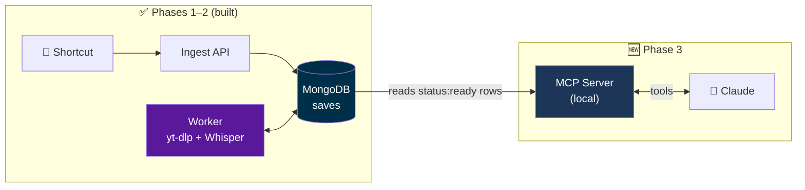

**Read it as:** nothing new is *produced* in Phase 3 (except, optionally, embeddings later).
Every row the worker marked `ready` already has what Claude needs:

```
{ _id, owner, platform, title, uploader, durationSec, thumbnailUrl,
  transcript, transcriptLang, segments, note, capturedAt,
  status:"ready", read:false }
```

The MCP server's whole job is to **read these rows and hand them to Claude in the right size
at the right moment**. Like the API, it **never talks to Instagram/TikTok/Facebook** — zero ban risk.

---

## 2. What MCP actually is

**MCP = Model Context Protocol.** An open standard for connecting AI apps to outside tools and
data — often called *"USB-C for AI"*.

- **Without MCP:** every AI app needs custom glue code for every data source (N apps × M sources).
- **With MCP:** you write **one server**; any MCP-capable app (Claude Desktop, Claude Code,
  claude.ai, and other vendors' apps) can plug into it.

### The three roles

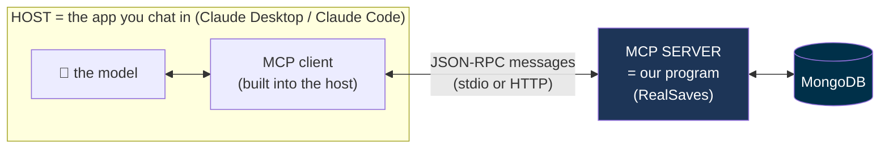

| Role | What it is | Do we write it? |
|---|---|---|
| **Host** | The app you use (Claude Desktop, Claude Code…) | No |
| **Client** | A component inside the host that speaks the protocol on the model's behalf | No |
| **Server** | A program that says *"here's what I can do"* and does it when asked | **Yes — this is Phase 3** |

**Read it as:** the model never touches MongoDB. It asks the client, the client asks our server,
our server queries MongoDB and replies. Our server is the only piece that knows about Mongo.

### The three things a server can offer ("primitives")

| Primitive | Who decides to use it | Analogy | RealSaves example |
|---|---|---|---|
| **Tools** | **The model** decides to call them | functions Claude can run | `list_new_reels`, `get_reel` ← **our main one** |
| **Resources** | The user / app attaches them | files you drag into a chat | a reel exposed as `reel://abc123` |
| **Prompts** | **The user** picks them | slash-command templates | a `/reel-briefing` command |

We'll mostly build **tools**. Resources and prompts are optional extras.

### What a tool really is

A tool is three things: a **name**, a **plain-English description**, and an **input schema**
(the types of its arguments). This is what the server announces to Claude — it's protocol data,
not our code:

```json
{
  "name": "get_reel",
  "description": "Get the full transcript of one saved reel by id. Use after list_new_reels or find_reels when the user wants the details.",
  "inputSchema": {
    "type": "object",
    "properties": { "id": { "type": "string" } },
    "required": ["id"]
  }
}
```

And when Claude decides to use it, the client sends:

```json
{ "method": "tools/call", "params": { "name": "get_reel", "arguments": { "id": "abc123" } } }
```

> 🔑 **Key insight:** Claude reads the **description** to decide *when* to call a tool.
> The description *is* a prompt. A vague description → Claude calls the tool at the wrong
> times (or never). Writing good tool descriptions is most of the craft in Phase 3.

### Why MCP here, and not something else?

| Option | Why not |
|---|---|
| Copy-paste transcripts into chat | Manual — defeats "capture and forget" |
| Give Claude a REST API | Chat Claude can't call an arbitrary API unless connected through something like MCP |
| **MCP server** ✅ | Claude calls it by itself, works across several Claude apps, data stays on your side, and it's the industry-standard skill you want to learn |

---

## 3. One conversation, arrow by arrow (happy path)

Same style as diagram 2 in [`worker/EXPLAINED.md`](worker/EXPLAINED.md): each arrow is a
message; the note on the way back is what comes back.

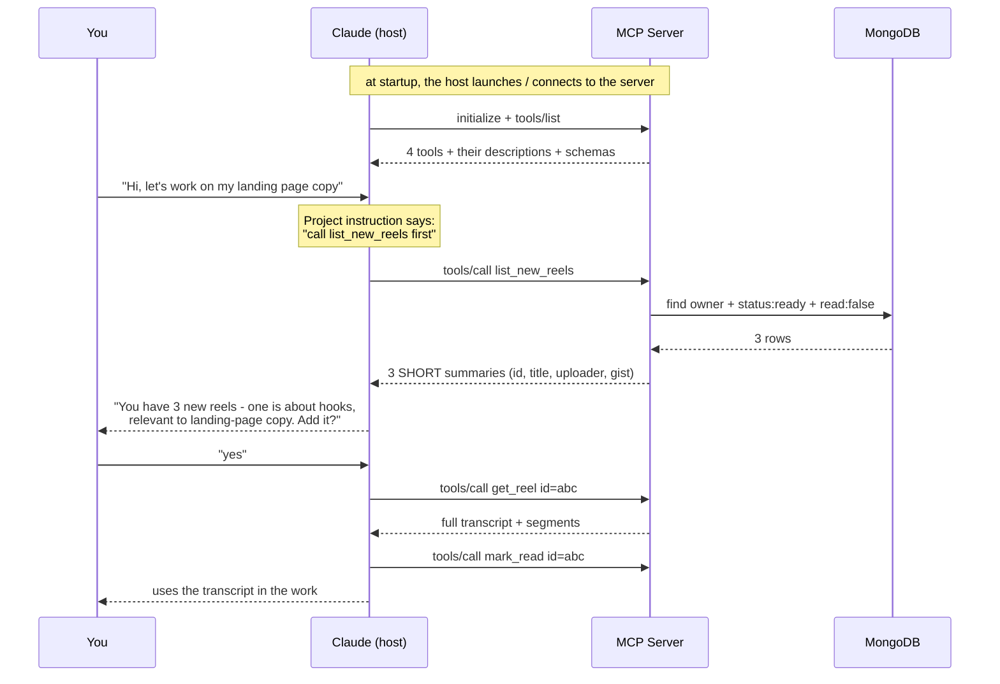

**Read it as:** two phases. **Handshake** (once, at startup: "what tools do you have?") and
**calls** (during the chat, whenever Claude decides).

### Pattern to notice: cheap list, expensive detail

`list_new_reels` returns **summaries**, not transcripts. Only `get_reel` returns the full text.

Why? **The context budget.** Everything a tool returns goes into Claude's context window (its
working memory). 20 unread transcripts could be 20k+ tokens dumped into *every* conversation
for nothing. So:

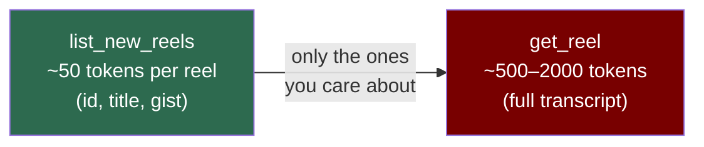

---

## 4. The tools

| Tool | Input | Output | Reads / Writes |
|---|---|---|---|
| `list_new_reels` | optional `limit` | unread `ready` reels as short summaries | read |
| `find_reels` | `topic` (text) | matching reels, ranked | read |
| `get_reel` | `id` | full transcript + metadata + `segments` (for *"at 0:42 they say…"*) | read |
| `mark_read` | `id` | ok | **write** (the only one) |

Two rules that apply to every tool:

- **Always filter by `owner`.** The API is multi-tenant, so the MCP server must know *whose*
  reels it serves. For a local server that can simply be a setting (env var).
- **Only `status:"ready"` rows.** `pending` / `processing` / `failed` rows have no transcript yet —
  surfacing them would just be noise.

---

## 5. The proactive greeting — and the pull-based caveat

This is the most important thing to understand correctly.

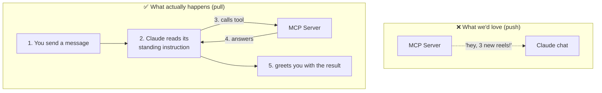

### Why it's pull-based

- The **model only runs when you send a message.** No message → no model → nothing happens.
- MCP messages *can* go both ways (a server can send small notifications like *"my tool list
  changed"*), but **no MCP feature lets a server write a message into your chat** or wake
  Claude up. The server **answers**; it never starts the conversation.

### How we fake "proactive"

A **standing instruction** makes Claude call the tool at the start of every conversation:

> *"At the start of each conversation, call `list_new_reels`. If any relate to this project,
> tell me how many and which, and ask if I want to add them."*

So the "push" happens right after your **first message**. For this use case, that's good enough.

### Honest limits

1. Nothing happens until you type something.
2. Claude **follows instructions**, it doesn't **execute code** — once in a while it may skip the call.
3. The call costs a bit of time and some tokens in every conversation.

### Where the instruction can live (→ decision D5)

| Place | How it works | Reliability |
|---|---|---|
| **Claude Project instructions** | You paste the instruction into a Project; every chat in it starts with it | ✅ high — the model always sees it |
| **Server `instructions` field** | The server describes itself at handshake; the host *may* show it to the model | ⚠️ depends on the host |
| **An MCP prompt** (e.g. `/reel-briefing`) | You trigger it by hand | ✅ reliable, but not automatic |

---

## 6. Relevance — how "this reel relates to your project" gets decided

The most interesting part to learn from. Three tiers, as in `ARCHITECTURE.md` §9:

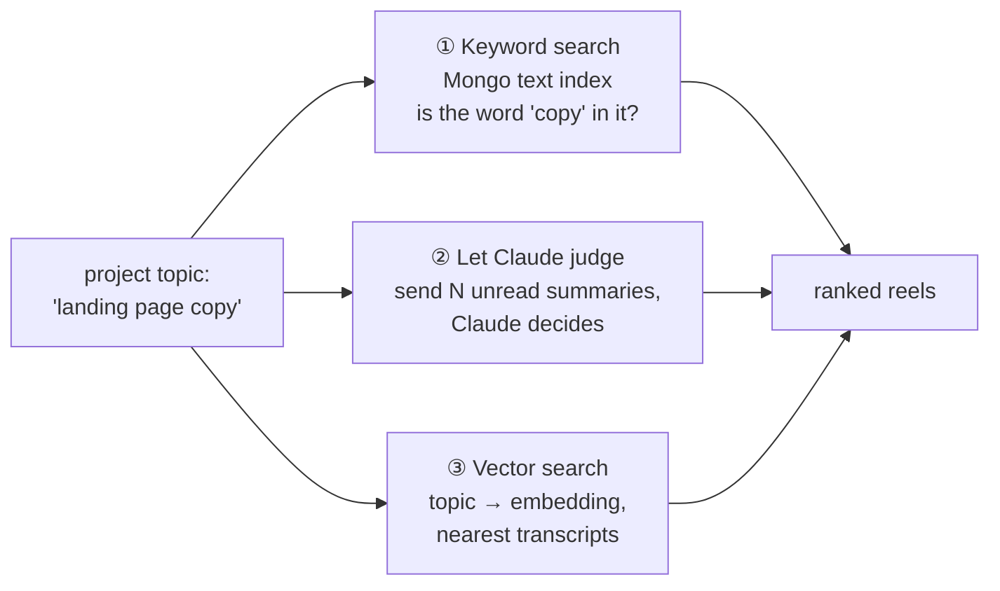

### The idea behind each tier

- **① Keyword:** match words. Fast and dumb — `"hook"` does not match `"attention grabber"`.
- **② Claude judges:** the server doesn't rank at all. It returns the recent unread summaries
  and Claude — which already understands meaning — decides what's relevant.
- **③ Vector (semantic) search:** an **embedding model** turns text into a list of numbers (a
  vector) where *similar meaning → nearby vectors*. Store one vector per transcript; at query
  time, embed the topic and fetch the closest ones. MongoDB Atlas has this built in
  (**Atlas Vector Search**), so no extra database.

### Comparison

| | ① Keyword | ② Claude judges | ③ Vector |
|---|---|---|---|
| **How** | Mongo `$text` index / Atlas Search | return recent unread; Claude ranks | store `embedding` per reel; nearest-neighbour search |
| **Catches synonyms** | ❌ | ✅ | ✅ |
| **Cross-language** (French reel, English project) | ❌ **big problem for you** | ✅ | ✅ only with a *multilingual* embedding model |
| **Scales to 1000s of reels** | ✅ | ❌ context fills up fast | ✅ |
| **Extra infra** | an index | none | embedding model + backfill old reels + vector index (needs real **Atlas**, not local Mongo) |
| **What you learn** | a little | tool design, context budgeting | embeddings, vector indexes, ranking — very marketable |

> ⚠️ **Why the cross-language row matters for you:** your reels are in Arabic, French, and
> English. Pure keyword search will *silently* miss a lot.

### Recommendation

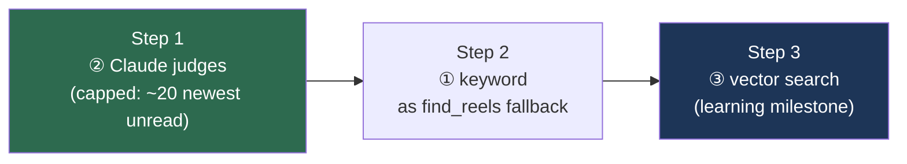

- **Start with ②** — zero infra, multilingual for free, works well while you have tens of reels.
- **Add ①** as a cheap fallback for `find_reels`.
- **Do ③ as a deliberate milestone** — a local multilingual embedding model (fits your "local
  models" goal), computed by the **worker** right after transcription. `find_reels` keeps the
  same name and input; only its insides change. Existing reels need a one-time backfill.

---

## 7. Decisions we'll face (preview — not choosing yet)

Each one gets criteria + pros/cons + a recommendation in the plan. This is just the map.

| # | Decision | Options | Leaning |
|---|---|---|---|
| **D1** | **Transport / which Claude** | **stdio** — the host launches our server as a local process (Claude Desktop, Claude Code) vs **remote HTTP** — reachable from claude.ai web + mobile, but needs public hosting + OAuth login | ✅ **Decided: stdio.** Note: §9 says "Desktop / web", but web requires the remote option → a later Phase 3.5 |
| **D2** | **Language** | **Python** (official `mcp` SDK v2 / `MCPServer` — called `FastMCP` in v1; reuses `worker/db.py`; embedding models are Python-native) vs **Node** (official TypeScript SDK, matches the API) | ✅ **Decided: Python** (worker + server share one embedding model later) |
| **D3** | **Relevance** | ① / ② / ③ (section 6) | ② → ① → ③ |
| **D4** | **What "read" means** | read = *listed*? *opened*? *used*? | Separate "surfaced" from "used" (`readAt`), so a reel you ignored once isn't lost forever |
| **D5** | **Where the greeting lives** | Project instructions / server `instructions` / MCP prompt (section 5) | Project instructions, with a prompt as manual backup |
| **D6** | **Output size** | full transcripts vs summaries + on-demand detail | Summaries in lists; full text only in `get_reel` |
| **D7** | **Safety** | read-only tools + one narrow write | Mark read tools as read-only; treat transcripts as **untrusted data** ↓ |

### About D7 — prompt injection (worth understanding)

A transcript is **text spoken by a stranger on the internet**. A reel could literally say
*"ignore previous instructions and…"* — and Claude reads it as tool output.

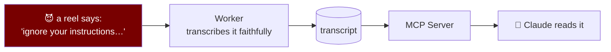

Stakes are low here (almost every tool is read-only, the only write is `mark_read`), but the
habit matters: **data from tools is data, not instructions.** Good design + a good interview topic.

---

## 8. Learning order (a sketch, not the plan)

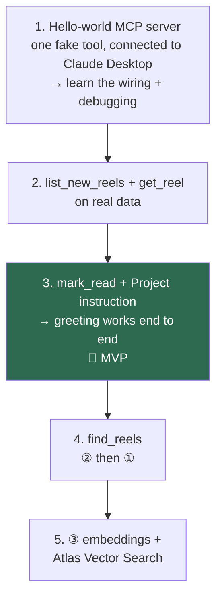

---

## 9. Deep dive: what REALLY happens when you ask "What new reels have I saved?"

This section follows **one real question** (tested on 2026-10-01) from your keyboard to MongoDB
and back. If MCP still feels blurry, this is the part to read slowly.

### 9.1 The missing piece: the model is NOT on your computer

This is the fact most people miss, and everything else follows from it.

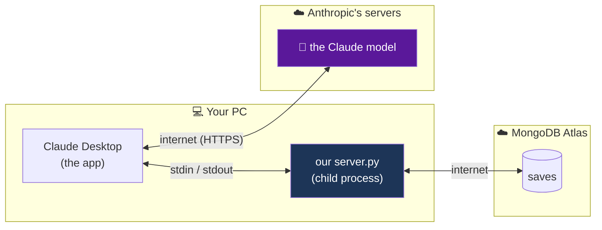

- **The model** (the "brain") runs in Anthropic's cloud. It **cannot** reach your PC, start
  programs, or talk to our server. All it can do is read text and **write text**.
- **Claude Desktop** (the app on your PC) is the middleman. It talks to the model over the
  internet, AND it started our `server.py` and holds its stdin/stdout.
- So when "Claude calls a tool", what really happens is: the model **writes a request**
  ("I'd like to call `list_new_reels` with `{limit: 20}`"), and **Claude Desktop actually
  runs it** on your PC, then hands the result back to the model.

> The model is like a **manager on the phone**: it can't touch anything in the office. It says
> "please pull the reels file, the 20 newest". The **assistant in the office** (Claude Desktop)
> walks to the **filing cabinet** (our server), gets the file, and reads it back over the phone.

### 9.2 A web-dev analogy (you already know this!)

| Web world | MCP world (our project) |
|---|---|
| A backend API | our MCP server (`server.py`) |
| An endpoint (`GET /reels/new`) | a tool (`list_new_reels`) |
| OpenAPI / Swagger docs | the tool list: names + descriptions + schemas (`tools/list`) |
| An HTTP request + JSON response | `tools/call` + its JSON result |
| HTTP over the network | JSON-RPC over **stdin/stdout** (stdio) |
| The **developer** reading the docs and deciding which endpoint to call | the **model** reading the tool descriptions and deciding which tool to call |
| The browser's `fetch()` actually sending the request | **Claude Desktop** actually sending `tools/call` |

The only truly new idea: **the one choosing which endpoint to call is an AI, deciding at
runtime, by reading your descriptions**. That's why descriptions matter so much.

### 9.3 The full timeline, step by step

**Part A: once, when Claude Desktop starts**

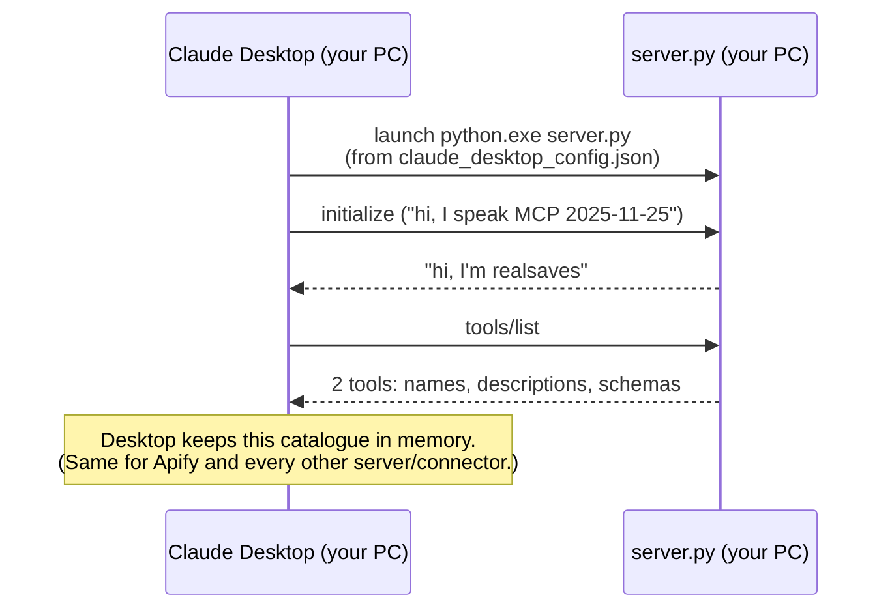

Nothing has happened in the chat yet. Desktop just knows "realsaves offers these 2 tools".

**Part B: every time you send a message**

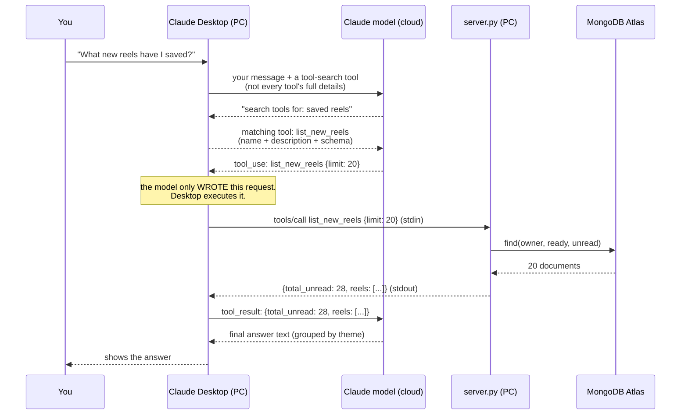

Map it to what you saw in the chat UI:

| What you saw in Claude Desktop | Which arrow above |
|---|---|
| "Searched available tools: **saved reels**" | the model searching the tool catalogue |
| "List new reels" → **Request** `{"limit": 20}` | the model's `tool_use` request |
| **Response** `{"total_unread": 28, …}` | what our server sent back (stdout) |
| "You've got 28 unread reels…" | the model's final answer, written from the response |

Notice: **the model makes several round trips** for one question (search → call → answer),
and our server is only involved in one of them.

### 9.4 "Tool search": why the first step was a search

You have **many** tools connected: Apify, Gmail, Canva, Higgs, Motion… plus ours. Each tool
comes with a description + schema. Sending **all of them** to the model on **every** message
would waste a lot of its context window (its working memory).

So Claude Desktop (as far as we can tell from the UI) does this instead:

```
  Without tool search                         With tool search (what you saw)
  ───────────────────                         ───────────────────────────────
  every message carries ALL tool details      every message carries ONE "search tools" tool
  (100s of descriptions + schemas)            
                                              model: "search: saved reels"
                                              Desktop: here's list_new_reels (+ get_reel?)
  model picks one                             model picks one
```

It's like **searching the API docs** instead of reading all of them every time.

**Why this matters for us:** the model searched with the words **"saved reels"** (taken
from your question). Our tool was found because its description contains those words:
*"List the user's newest UNREAD **saved reels** (Instagram/TikTok/Facebook videos…)"*.
So a description has **two jobs**:

1. **Be found**: use the words a user would naturally say ("saved", "reels", "videos").
2. **Be chosen correctly**: say clearly what the tool does and when to use it.

### 9.5 The 5 facts to remember

1. **The model lives in the cloud; it only writes text.** It never touches your PC.
2. **Claude Desktop is the middleman:** it runs our server, executes the model's requests,
   and passes results back.
3. **Our server is a backend whose "endpoints" are tools**; stdio replaces HTTP.
4. **The model picks tools by reading descriptions** (and first *finds* them via tool search).
5. **One question = several round trips** between Desktop and the model; our server only
   answers the `tools/call` ones.

---

## 10. Glossary

| Term | Meaning |
|---|---|
| **MCP** | Model Context Protocol — the open standard connecting AI apps to tools/data |
| **Host** | The app you chat in (Claude Desktop, Claude Code) |
| **Client** | The part of the host that talks MCP to a server |
| **Server** | Our program that exposes tools (the RealSaves MCP server) |
| **Tool** | A function the **model** can decide to call (name + description + input schema) |
| **Resource** | Data the **user/app** can attach, like a file |
| **Prompt** | A template the **user** triggers, like a slash command |
| **stdio** | Transport where the host starts the server as a local process and they talk via stdin/stdout |
| **Streamable HTTP** | Transport for remote servers over the network (needed for claude.ai web/mobile) |
| **JSON-RPC** | The simple request/response message format MCP uses under the hood |
| **Context window** | The model's working memory for one conversation — tool outputs fill it |
| **Embedding** | A vector of numbers representing a text's meaning; similar meaning → nearby vectors |
| **Vector search** | Finding the stored embeddings closest to a query embedding |
| **Prompt injection** | Untrusted text (e.g. a transcript) trying to act like instructions to the model |
| **tool_use** | The model's written request to call a tool (name + arguments). The host executes it |
| **tool_result** | What the host sends back to the model after running the tool |
| **Tool search** | The host gives the model a search tool instead of every tool's full details; the model finds tools by keywords first |
