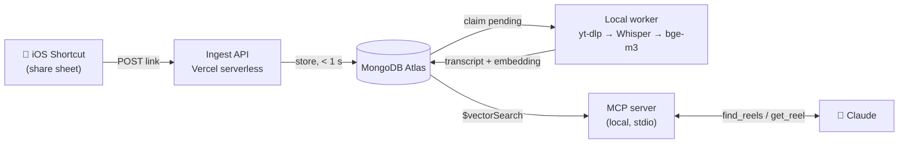

# RealSaves

**Turn the reels you save into a knowledge base Claude can search by meaning, in any language.**

I save a lot of short videos (Instagram, TikTok, Facebook) with useful ideas in them, and I
never watch them again. RealSaves fixes that. One tap in the share sheet saves the reel. A
local worker transcribes it and embeds it. When I start a task in Claude (*"today: SEO for our
landing page"*), Claude finds the related reels through an MCP server, asks whether I want to
use them, and applies their ideas.

Transcription and embeddings run **locally**: no paid AI API, and the audio never leaves the
machine. The cloud parts run on free tiers (Vercel, MongoDB Atlas M0).

The project is also a **learning path**. Each phase comes with a study guide written *before*
the code: the concepts, the decisions and their trade-offs, the pitfalls, and what we measured
afterwards. You can read the code and the reasoning behind it side by side.

## How it works



| Phase | What it does | Stack |
|---|---|---|
| **1. Capture** | One iOS Shortcut accepts links from every app. A serverless API parses the platform and ID, removes tracking params, deduplicates per user and stores the save | Node.js, Vercel, MongoDB Atlas |
| **2. Transcribe** | A local worker resolves short links, downloads audio only, transcribes it and handles failures and retries | Python, yt-dlp, ffmpeg, faster-whisper |
| **3. Search** | Each reel becomes a 1024-dim vector. An MCP server gives Claude read-only tools to search reels by meaning and read them (RAG) | bge-m3 on onnxruntime, Atlas Vector Search, MCP Python SDK |

## What you'll learn by building it

Each row is a real problem this project had to solve, with where to read about it.

| Concept | The problem it solves here | Read |
|---|---|---|
| **Serverless ingest under a timeout** | The iOS Shortcut gives up after a few seconds, so the API stores the save and returns. All slow work happens later. The Mongo client is cached across warm invocations | [api/](api/README.md) |
| **Multi-tenancy with API keys** | One key both authenticates the user and identifies them. Every row has an `owner`, and dedup is a *partial* unique index on `{owner, dedupKey}` | [api/](api/README.md) |
| **Messy real-world input** | TikTok and Facebook share links hide the real video ID behind a redirect. The ID is stored as provisional, resolved later, and duplicates are merged when the same video arrives through two different links | [ARCHITECTURE §6](ARCHITECTURE.md) |
| **A job queue on a plain database** | A `status` state machine with an atomic claim (`findOneAndUpdate`). Stale jobs are reclaimed after a crash, attempts are capped, and failures keep their reason | [worker/EXPLAINED](worker/EXPLAINED.md) |
| **Where to run what** | Only the local worker ever contacts the platforms, from a home IP. Datacenter IPs get blocked; the cloud API never scrapes | [ARCHITECTURE §8](ARCHITECTURE.md) |
| **Local speech-to-text** | Whisper model sizes, CPU int8 vs GPU, language auto-detection, timestamped segments | [ARCHITECTURE §7](ARCHITECTURE.md) |
| **Embeddings & cosine similarity** | Turning meaning into numbers, so a query like "SEO" also finds a reel in Arabic about "ranking on Google" | [VECTOR-SEARCH-EXPLAINED](VECTOR-SEARCH-EXPLAINED.md) |
| **Running a model without PyTorch** | bge-m3 as ONNX on `onnxruntime`, pinned to a commit, because vectors are only comparable within one model | [shared/](shared/README.md) |
| **Evaluating retrieval** | Choosing a model and threshold *by measuring on your own data* instead of guessing (see the numbers below) | [shared/](shared/README.md) |
| **MCP from scratch** | What a host, client, server and tool are; JSON-RPC over stdio; read-only tools; why the server can't push into a chat | [PHASE3-EXPLAINED](PHASE3-EXPLAINED.md), [mcp_server/EXPLAINED](mcp_server/EXPLAINED.md) |
| **RAG, end to end** | Retrieve the related reels, ask the user, then let Claude apply them to the task without just recapping the transcript | [VECTOR-SEARCH-EXPLAINED §6](VECTOR-SEARCH-EXPLAINED.md) |

### Suggested reading order

1. [`ARCHITECTURE.md`](ARCHITECTURE.md): the whole system, the status state machine and the schema
2. [`worker/EXPLAINED.md`](worker/EXPLAINED.md): how the worker's files and functions call each other, with diagrams
3. [`PHASE3-EXPLAINED.md`](PHASE3-EXPLAINED.md): MCP concepts, then one request traced arrow by arrow
4. [`VECTOR-SEARCH-EXPLAINED.md`](VECTOR-SEARCH-EXPLAINED.md): embeddings, vector indexes, RAG, the decisions and the pitfalls
5. [`vector-search-illustration.html`](vector-search-illustration.html): a clickable walkthrough of the data flow (download it and open it in a browser)
6. [`shared/playground.py`](shared/playground.py): your first hands-on experiment. It embeds Arabic, French and English sentences and prints their similarity, with no database needed

## Decisions, with numbers

- **Vector search over keywords or "send Claude every summary".** Keywords miss synonyms and
  cross-language matches. Sending every summary costs about 4k tokens in *every* chat, and that
  grows with the library. Vector search sends only the few closest reels.
- **bge-m3 over multilingual-e5-small**, measured on 76 real reels (English + Arabic dialects)
  and 12 topics:

  | Model | Dims | Expected reels in top 5 | Avg similarity, relevant vs other |
  |---|---|---|---|
  | multilingual-e5-small | 384 | 75% | 0.85 vs 0.80 |
  | **bge-m3** | 1024 | **84%** | **0.58 vs 0.41** |

  The second column matters as much as the first. e5-small gives every reel a similar score,
  so no threshold separates relevant reels from unrelated ones.
- **Local Whisper (`small`, CPU int8) over a hosted API.** It is free and private, and fast
  enough for 15–90 s clips running in the background.

## Run it yourself

You need Node 20+, Python 3.12+, ffmpeg, a free MongoDB Atlas cluster and Claude Desktop. An
iPhone is optional; `curl` works for saving links too. Set it up in this order:

1. **Ingest API**: [`api/README.md`](api/README.md) (run locally or deploy to Vercel, plus the iOS Shortcut)
2. **Worker**: [`worker/README.md`](worker/README.md) (`python worker/worker.py`)
3. **Vector search**: [`shared/README.md`](shared/README.md) (embed your reels, create the Atlas index)
4. **MCP server**: [`mcp_server/README.md`](mcp_server/README.md) (connect it to Claude Desktop, add the trigger instruction)

## Project layout

```
api/, lib/          # Phase 1: ingest API (Node, Vercel)
worker/             # Phase 2: resolve + transcribe + embed (Python, runs locally)
shared/             # Phase 3: embedding model, evaluation, vector index (worker + MCP server)
mcp_server/         # Phase 3: MCP server for Claude Desktop
ARCHITECTURE.md     # full system design
*-EXPLAINED.md      # study guides
```

## Status

Phases 1–3 are built and working end to end. **Next:** write the "key ideas" of each reel once at save
time, so Claude can read a short summary instead of the full transcript. After that: a remote
(HTTP) MCP server for claude.ai web and mobile.

**Known limits:** Whisper `small` struggles with some Arabic dialects (Claude usually recovers
the meaning from context). Facebook sometimes shows a login wall, and those reels are marked
`failed`. MCP is pull-based, so Claude searches when your first message triggers it, not on
its own.

## Responsible use

RealSaves is a personal tool. It downloads audio only from videos you chose to save, keeps
only the transcript, and is meant for low-volume personal use. Respect each platform's terms
and the creators' rights.

## License

[MIT](LICENSE): use it, change it, learn from it.
