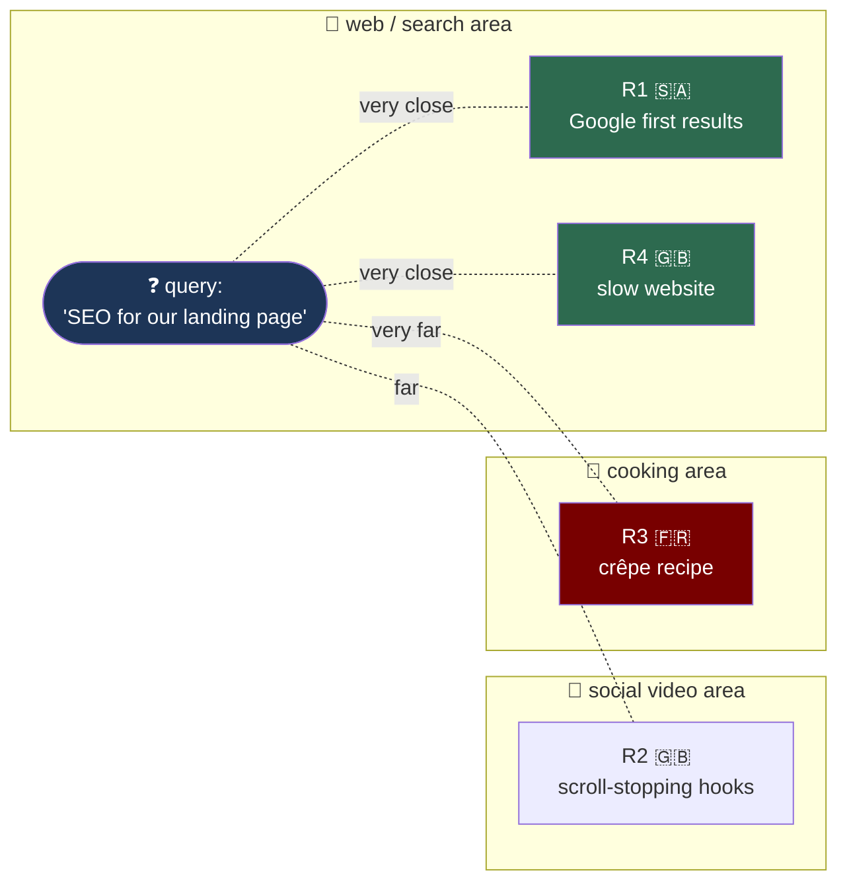
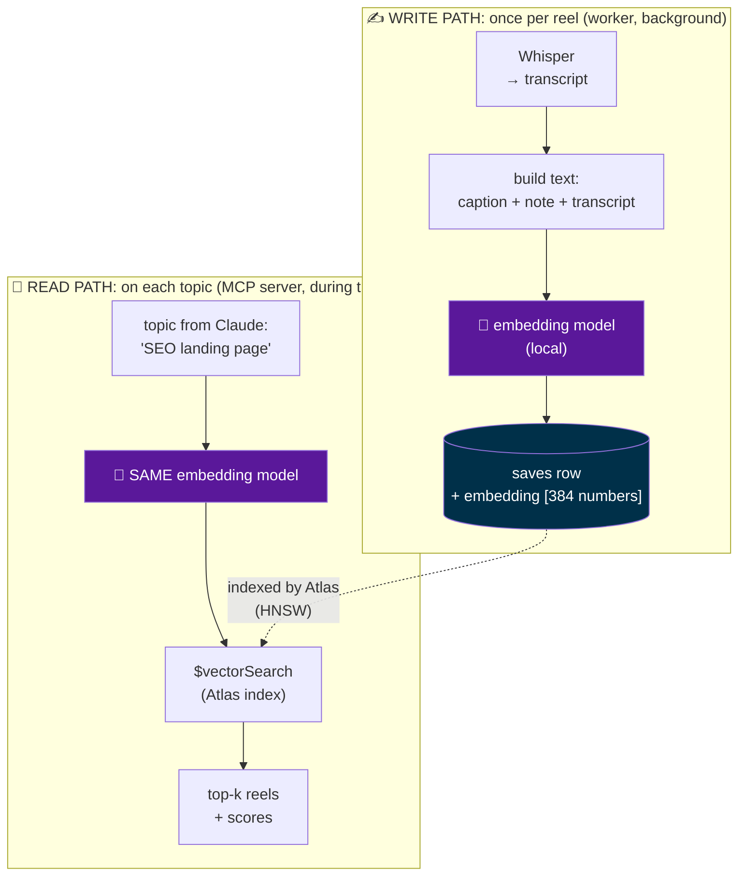
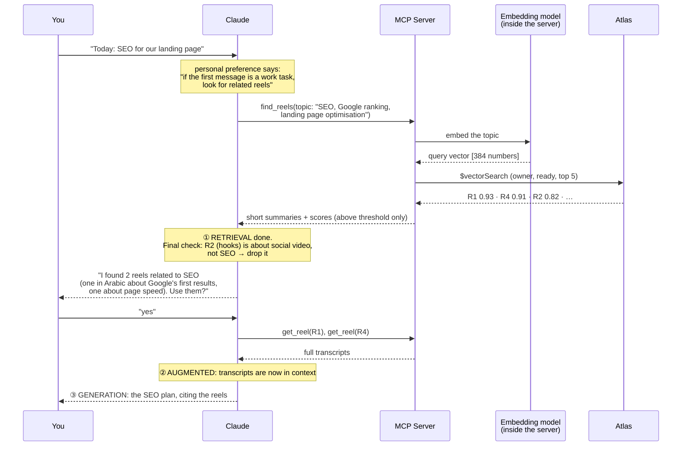
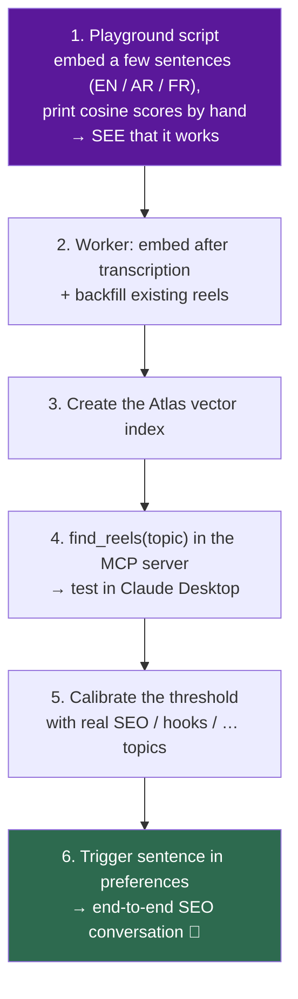

# Vector Search, Explained — embeddings, Atlas Vector Search & RAG

A study guide for the second half of Phase 3, **written before any code** (and updated after
it was built: §11 has what we measured and decided). It explains what
embeddings are, how vector search finds "reels about the same thing", and how all of this turns
RealSaves into a small **RAG** system. It ends with the decisions we'll make in the plan.
Read [`PHASE3-EXPLAINED.md`](PHASE3-EXPLAINED.md) first. This guide continues from its §6, tier ③.

> Mental model: in Phase 3 so far, the librarian (the MCP server) can hand Claude a **list of
> new books** or **one book by its id**. Now we teach the librarian to **shelve books by
> meaning**: every book gets a position on a giant map, and books about the same idea sit close
> together, whatever language they're written in. When you say *"SEO"*, the librarian walks to
> the SEO part of the map and brings back what's shelved nearby.

---

## 0. What changed since PHASE3-EXPLAINED.md

On 2026-10-02 we reframed the product. This guide is built on the new version:

| Before (PHASE3-EXPLAINED §5) | Now |
|---|---|
| Reels are an **inbox**: show the *unread* ones | Reels are a **library**: one reel can help in many chats. Search **all** `ready` reels |
| Greeting: *"you have 3 new reels"* | Topic trigger: you state a task → *"I found 3 reels related to SEO, want to use them?"* |
| `mark_read` marks what you've seen | `mark_read` **dropped for now** |
| Relevance: start with ② "Claude judges" | Relevance: **③ vector search** (option B) |

**Why option B, and not "send Claude every summary" (option A)?**

1. **Learning goal:** embeddings, vector indexes and RAG are the core skills behind most AI
   products today.
2. **Token cost:** sending all summaries costs ~4k tokens **in every chat** today, and that
   number grows with every reel you save. Vector search sends only the few closest ones.

---

## 1. The problem, with your SEO example

You open Claude and write: **"Today: SEO for our landing page."**

Somewhere in your library there are these reels (simplified):

| Reel | Language | What it says |
|---|---|---|
| **R1** | Arabic | *"كيف تظهر في أول نتائج جوجل…"* ("how to show up in Google's first results…": keywords, page titles) |
| **R2** | English | *"5 hooks that stop the scroll in the first 2 seconds"* |
| **R3** | French | *"La recette de crêpes de ma grand-mère"* (grandma's crêpe recipe) |
| **R4** | English | *"Your website loads slowly and Google punishes you for it"* |

The right answer is **R1 and R4**. Now try with keyword search (tier ①):

```
  query word   │ R1 (Arabic)  │ R2 │ R3 │ R4
  ─────────────┼──────────────┼────┼────┼──────────────────────────────
  "SEO"        │ ✗ not there  │ ✗  │ ✗  │ ✗ (it says "Google", not "SEO")
  "landing"    │ ✗            │ ✗  │ ✗  │ ✗
  "page"       │ ✗ (Arabic)   │ ✗  │ ✗  │ ✗ ("website")
  → result: nothing found. Both good reels are missed.
```

Keyword search matches **letters**. We need a search that matches **meaning**, even across
languages. That is what embeddings give us.

---

## 2. Embeddings — turning meaning into numbers

An **embedding model** is a function:

```
  text  ──►  [ embedding model ]  ──►  a list of numbers (a vector)
```

It was trained on billions of sentences so that **texts with similar meaning get similar
numbers**. Nobody wrote rules like "SEO ≈ Google ranking"; the model learned it from data.

### 2.1 A toy version you can compute by hand

Real vectors have hundreds of numbers. To build intuition, imagine a model with only **3**,
where each number means one theme:

```
  [ web-search-ness , social-video-ness , cooking-ness ]
```

| Text | Vector (toy) |
|---|---|
| **Query:** "SEO for our landing page" | `[0.90, 0.30, 0.00]` |
| R1 (Arabic, Google first results) | `[0.80, 0.20, 0.00]` |
| R2 (scroll-stopping hooks) | `[0.30, 0.90, 0.00]` |
| R3 (crêpe recipe, French) | `[0.00, 0.10, 0.95]` |
| R4 (slow website, Google punishes) | `[0.85, 0.10, 0.05]` |

Notice that **R1 is in Arabic and still lands right next to the English query**. The numbers
describe *what the text is about*, not *which language it uses*. (That only works with a
**multilingual** model. More in decision V1.)

### 2.2 The real thing

| | Toy | Real (e.g. `multilingual-e5-small`) |
|---|---|---|
| Numbers per vector ("dimensions") | 3 | **384** |
| Can a human read each number? | yes ("cooking-ness") | **no**: meaning is spread across all 384 |
| Example | `[0.90, 0.30, 0.00]` | `[0.0213, -0.0871, 0.0442, …381 more]` |

> 🔑 **Key insight:** you never look at the numbers. You only ever ask one question about two
> vectors: **"how close are they?"**

### 2.3 Picture it as a map



---

## 3. Measuring "close" — cosine similarity

The usual measure for text embeddings is **cosine similarity**: it looks at the **angle**
between two vectors (do they point in the same direction?) and ignores their length.

```
   cosine =  1.0  → same direction   → same meaning
   cosine ≈  0    → 90° apart        → unrelated
   cosine = -1.0  → opposite         → (rare with text models)
```

Formula (you won't write it, the database does it):

```
                 a · b            (sum of a[i] × b[i])
  cos(a, b) = ─────────── = ──────────────────────────────
              |a| × |b|      (length of a) × (length of b)
```

### Worked example with the toy vectors

```
  query = [0.90, 0.30, 0.00]                          |query| = 0.949

  R1 = [0.80, 0.20, 0.00]   dot = 0.72+0.06+0    = 0.78   |R1| = 0.825   cos = 0.78/(0.949×0.825) ≈ 0.99 ✅
  R4 = [0.85, 0.10, 0.05]   dot = 0.765+0.03+0   = 0.795  |R4| = 0.857   cos ≈ 0.98 ✅
  R2 = [0.30, 0.90, 0.00]   dot = 0.27+0.27+0    = 0.54   |R2| = 0.949   cos ≈ 0.60
  R3 = [0.00, 0.10, 0.95]   dot = 0+0.03+0       = 0.03   |R3| = 0.955   cos ≈ 0.03 ❌
```

Ranked: **R1 (0.99), R4 (0.98)**, R2 (0.60), R3 (0.03). Both good reels win, including the
Arabic one. Keyword search found nothing.

### ⚠️ Two traps about scores

1. **"Closest" is not the same as "relevant".** Vector search **always** returns the top-k,
   even if your library has nothing about SEO. Ask for 3 and you get 3, even if the best one is
   the crêpe recipe. So we need a **threshold** (minimum score) **and** Claude's final check.
2. **Scores are not percentages, and they differ per model.** Some models (the `e5` family is
   known for this) put even unrelated texts at cosine 0.7+. Atlas also **rescales** cosine to
   `score = (1 + cosine) / 2`, so the range becomes 0..1. → The threshold must be **measured on
   our own reels**, not guessed. (It will be a step in the plan.)

---

## 4. Vector search — finding the nearest ones fast

### 4.1 The naive way: compare with everything

```
  for each reel in the library:
      score = cosine(query_vector, reel.embedding)
  sort by score, keep the top 5
```

This is called **exact** or **brute-force** search (Atlas calls it **ENN**, *exact nearest
neighbours*). It's 100% accurate and its cost grows with the library: 1 million reels = 1
million comparisons per query.

### 4.2 The index way: a "highway map"

A **vector index** pre-organises the vectors so a query only visits a small part of the map.
Atlas uses **HNSW** (*Hierarchical Navigable Small World*). The intuition:

```
  Level 2 (highways)   A ─────────────── B ─────────────── C        few points, long jumps
                       │                 │
  Level 1 (roads)      A ──── d ──── B ──── e ──── C               more points
                                     │
  Level 0 (streets)    ... every vector, linked to its close neighbours ...

  Search: start on the highway, drive toward the query, exit to roads,
          then streets → arrive in the right neighbourhood after very few steps.
```

This is **ANN** (*approximate nearest neighbours*): super fast, and **almost** always finds the
true closest ones. Two knobs in Atlas:

| Knob | Meaning | Typical |
|---|---|---|
| `limit` | how many results you want back (the **k** in "top-k") | 3–5 |
| `numCandidates` | how many neighbours HNSW explores before choosing the best `limit` | 10–20 × `limit` |

More candidates → more accurate, a bit slower.

> 💡 **Honest note:** with ~40 reels, brute force would be instant, and you could even do it in
> Python without an index. We use Atlas Vector Search because **learning it is the goal** and
> because it's what you'd use at real scale. The code doesn't change when the library grows.

### 4.3 Filtering: only *my* ready reels

Every RealSaves query must keep the two rules from PHASE3-EXPLAINED §4: **only this owner**,
**only `status:"ready"`**. Atlas supports a **pre-filter**: fields declared as `filter` in the
index are applied *during* the search, not after. So you never get "top 5 → 3 of them belong to
another user → only 2 left".

---

## 5. Where it fits in RealSaves — two paths

Embeddings are used **twice**: when a reel is **stored** (write path) and when you **ask**
(read path).



> 🔑 **The golden rule:** both paths must use **the same model** (same name, same version).
> Vectors from two different models live on two different maps. Comparing them is like
> comparing GPS coordinates with street numbers: the result is a number, but it means nothing.
> That's why we'll store `embeddingModel` next to each vector. If we ever change model, we
> re-embed everything (the backfill script does exactly that).

### 5.1 What the data looks like (protocol data, not our code)

A `saves` row gains two fields:

```json
{
  "_id": "…", "owner": "alice", "status": "ready",
  "caption": "…", "note": "…", "transcript": "…",
  "embedding": [0.0213, -0.0871, 0.0442, "…1021 more"],
  "embeddingModel": "BAAI/bge-m3@5617a9f6"
}
```

The **index definition** you create once in Atlas (UI or code):

```json
{
  "fields": [
    { "type": "vector", "path": "embedding", "numDimensions": 1024, "similarity": "cosine" },
    { "type": "filter", "path": "owner" },
    { "type": "filter", "path": "status" },
    { "type": "filter", "path": "embeddingModel" }
  ]
}
```

The **query** the MCP server runs (an aggregation pipeline, like `find()` but with stages):

```json
[
  { "$vectorSearch": {
      "index": "reels_vector",
      "path": "embedding",
      "queryVector": [0.0187, -0.0912, "…"],
      "numCandidates": 100,
      "limit": 5,
      "filter": { "owner": "alice", "status": "ready", "embeddingModel": "BAAI/bge-m3@5617a9f6" }
  }},
  { "$project": { "caption": 1, "transcript": 1, "score": { "$meta": "vectorSearchScore" } } }
]
```

**Read it as:** "in the `reels_vector` index, look at ~100 neighbours of this query vector, only
among alice's ready reels embedded by the current model, return the best 5, and attach each one's
similarity score."

---

## 6. How this maps to RAG

**RAG = Retrieval-Augmented Generation.** A model only knows what was in its training data plus
what's in its context window. It has never seen *your* reels. RAG fixes that in three steps:

| Letter | Meaning | In RealSaves |
|---|---|---|
| **R**etrieval | find the few pieces of your data relevant to the question | `find_reels(topic)` → vector search → top-k + scores |
| **A**ugmented | put those pieces into the model's context | you say *yes* → `get_reel` puts the full transcripts into the chat |
| **G**eneration | the model answers using them | Claude writes your SEO plan, using ideas from R1 and R4 |

### 6.1 The full SEO conversation, arrow by arrow



Three things to notice:

1. **Claude writes the query, not you.** It can expand *"SEO for our landing page"* into
   *"SEO, Google ranking, keywords, page speed, landing page"*. This is **query rewriting**,
   and it often improves retrieval for free.
2. **Two filters for relevance:** the **threshold** in the server (cheap, mechanical) and
   **Claude's judgement** (smart, catches "close but off-topic" like R2).
3. **You are a gate.** Nothing enters the context until you say *yes*. Classic RAG pipelines
   inject retrieved text automatically. We added a human check because a reel can be useless
   for *today's* angle even when it's on-topic.

### 6.2 Classic RAG vs what we're building ("agentic RAG")

```
  Classic RAG (a fixed pipeline)            Agentic RAG (ours)
  ─────────────────────────────             ─────────────────────────────────────────
  every question                            the MODEL decides whether to retrieve
    → always embed + search                   (via a tool, guided by its instructions)
    → always paste top-k into the prompt    it writes the query itself
    → model answers                         it judges the results, can search again
                                            and here: asks you before using them
```

Same three letters. The difference is **who drives**: code, or the model through tools.
MCP tools are exactly what makes the agentic version possible.

### 6.3 The token budget, option A vs option B

```
  Option A: "send Claude every summary"     Option B: vector search (chosen)
  ─────────────────────────────────────     ─────────────────────────────────
  40 reels  × ~100 tokens ≈  4,000 tokens   5 summaries × ~100 tokens ≈ 500 tokens
  400 reels × ~100 tokens ≈ 40,000 tokens   5 summaries × ~100 tokens ≈ 500 tokens
  → grows with the library, every chat      → stays flat, whatever the library size
```

(Then, in both options, `get_reel` adds ~500–2,000 tokens per reel you accept.)

---

## 7. Decisions we faced

Written before building, with the leaning at the time. The **outcome** of each is in §11.

| # | Decision | Options | Leaning |
|---|---|---|---|
| **V1** | **Embedding model** | `multilingual-e5-small` (384 dims, ~470 MB, 512-token input) · `multilingual-e5-base` (768 dims, ~1.1 GB, better quality) · `bge-m3` (1024 dims, ~2.2 GB, 8k-token input, strong multilingual) · `paraphrase-multilingual-MiniLM-L12-v2` (384 dims, but only **128 tokens**: cuts most transcripts) | **e5-small** to start: multilingual incl. Arabic, light on CPU. Re-evaluate with real queries |
| **V2** | **What text to embed** | transcript only · caption + transcript · **caption + your note + transcript** | All three. Your note is *your* words, often the best signal of why you saved it |
| **V3** | **Chunking** (split long texts into pieces, one vector each) | one vector per reel · one per chunk (e.g. per ~30 s of segments) | **One per reel.** Reels are 15–90 s, mostly within the model's input limit. Chunking matters for books, not reels |
| **V4** | **top-k + threshold** | fixed k · k + minimum score | k = 5, `numCandidates` = 50, threshold **calibrated** on your reels with a few test topics |
| **V5** | **Where vectors live** | field on the `saves` row · separate `embeddings` collection | Field on the row: one doc = one reel, filters work directly |
| **V6** | **Atlas index on M0 (free)** | — | M0 allows **max 3** Atlas Search + Vector Search indexes in total. We need **1**. ✅ |
| **V7** | **When the server loads the model** | at startup · on the first `find_reels` call | Measure first. Loading takes a few seconds and Claude Desktop starts the server at launch |
| **V8** | **The trigger sentence** (Claude Desktop personal preferences) | wording | Fires only when the **first** message describes a work task. Never on "hi" or casual chat |

### About the `e5` prefixes (a gotcha worth knowing)

The `e5` models were trained with labels at the start of the text:

```
  stored reels  →  "passage: <caption + note + transcript>"
  the query     →  "query: SEO for our landing page"
```

Forget them and the model still returns numbers, but **quality drops silently**. Many models
have small rules like this; always read the model card. It's the same kind of bug as the
"same model on both sides" rule: nothing crashes, results just get worse.

---

## 8. Pitfalls checklist

| Pitfall | What happens | Our guard |
|---|---|---|
| Different model for write vs read | meaningless scores, no error | `embeddingModel` field + one shared constant |
| Missing `query:` / `passage:` prefix | quietly worse results | one helper function used by worker **and** server |
| Text longer than the model's input limit | the end is **silently cut** before embedding | caption + note first, transcript last (the cut hits the least important part) |
| Trusting top-k blindly | the crêpe recipe shows up for "SEO" | threshold + Claude's check |
| Reels saved before this feature | no `embedding` field → invisible to search | one-time backfill (like `worker/backfill.py`) |
| A transcript says "ignore your instructions…" | prompt injection via retrieved text | unchanged from PHASE3 D7: **retrieved data is data, not instructions** |

---

## 9. Learning order (a sketch, not the plan)



Step 1 is the most important for learning: before any database, you'll **see** an Arabic
sentence score close to its English equivalent, and a crêpe recipe score far away.

---

## 10. Glossary

| Term | Meaning |
|---|---|
| **Embedding** | A list of numbers representing a text's meaning; similar meaning → nearby vectors |
| **Embedding model** | The model that turns text into an embedding (runs locally for us) |
| **Dimensions** | How many numbers are in each vector (384 for e5-small). Fixed per model |
| **Multilingual model** | An embedding model trained so the same meaning in different languages lands close together |
| **Cosine similarity** | Closeness by angle: 1 = same direction, ~0 = unrelated |
| **Vector search** | Finding the stored vectors closest to a query vector |
| **ENN / exact search** | Compare the query with every vector. Accurate, slower at scale |
| **ANN** | Approximate nearest neighbours: uses an index to visit only part of the map. Fast, nearly exact |
| **HNSW** | The layered "highway map" index Atlas uses for ANN |
| **top-k / `limit`** | How many closest results to return |
| **`numCandidates`** | How many neighbours the index explores before picking the top-k |
| **Pre-filter** | Conditions (owner, status) applied during the vector search |
| **Threshold** | A minimum score below which results are dropped |
| **Chunking** | Splitting a long text into pieces, each with its own vector |
| **Query rewriting** | Rephrasing/expanding the user's words into a better search query |
| **RAG** | Retrieval-Augmented Generation: retrieve your data → put it in context → generate |
| **Agentic RAG** | RAG where the model decides when and what to retrieve, via tools |
| **Backfill** | A one-time job computing embeddings for rows that existed before the feature |

---

## 11. What we built, measured and decided

| # | Decision | Outcome |
|---|---|---|
| **V1** | Embedding model | **`bge-m3`** (1024 dims), not the e5-small we leaned towards: measured, see below |
| **V2** | Text to embed | caption + note + transcript ([`shared/reels.py`](shared/reels.py)), short parts first |
| **V3** | Chunking | none: one vector per reel. bge-m3 is capped at 2048 tokens (≈10 min of speech) |
| **V4** | top-k + threshold | k = 5, `numCandidates` = 100, similarity ≥ **0.50** |
| **V5** | Where vectors live | fields on the `saves` row: `embedding`, `embeddingModel`, `embeddedAt` |
| **V6** | Atlas M0 index | one `vectorSearch` index, `reels_vector` (M0 allows 3) |
| **V7** | Model loading | the MCP server loads it in a background thread at startup (~5 s) |
| **V8** | Trigger sentence | in Claude Desktop's instructions; wording in [`mcp_server/README.md`](mcp_server/README.md) |

**How the model was chosen: measure, don't guess.** [`shared/evaluate.py`](shared/evaluate.py)
embeds every real reel in memory and checks a hand-written test set (12 topics, each listing the
reels that *should* come back, 2 of them with no matching reel at all):

```
                       found in top 5   relevant vs others (avg)   best cut-off
  multilingual-e5-small     75%           0.85 vs 0.80  ← bunched    0.86 (F1 0.51)
  bge-m3                    84%           0.58 vs 0.41  ← separated  0.56 (F1 0.70)
```

e5-small ranked reasonably, but its scores were bunched together: a crêpe recipe scored almost like
an SEO reel, so no threshold could separate them. bge-m3 kept no-match topics below 0.45.

**Lessons the build taught (not in the plan):**

1. **Run the model without PyTorch.** The official repos ship ONNX exports; `onnxruntime` +
   `tokenizers` (already installed by faster-whisper) do the 4 steps of §2 in ~40 lines:
   tokenize, run, pool (bge-m3 keeps the first token, e5 averages them all), normalize.
2. **Attention memory grows with length².** One 7,000-token transcript in a batch of 8 asked for
   25 GB of RAM. Fixes: cap the input, and batch texts of similar length together.
3. **Atlas rescales the score.** `vectorSearchScore` is `(1 + cosine) / 2`; the server converts it
   back, so 0.50 means the same thing in `evaluate.py` and in production.
4. **The query's shape matters as much as the model.** Claude's first live query listed 12
   sub-topics in one string; its vector landed "in the middle" of all of them (top score 0.56,
   generic reels slipped in, a relevant one was missed). One focused topic per call scored ~0.63.
   The fix was one sentence in the tool description: the description *is* the prompt.
5. **Two filters beat one.** In the live tests the threshold passed 9 reels and Claude kept the 4
   that really fit the task.
