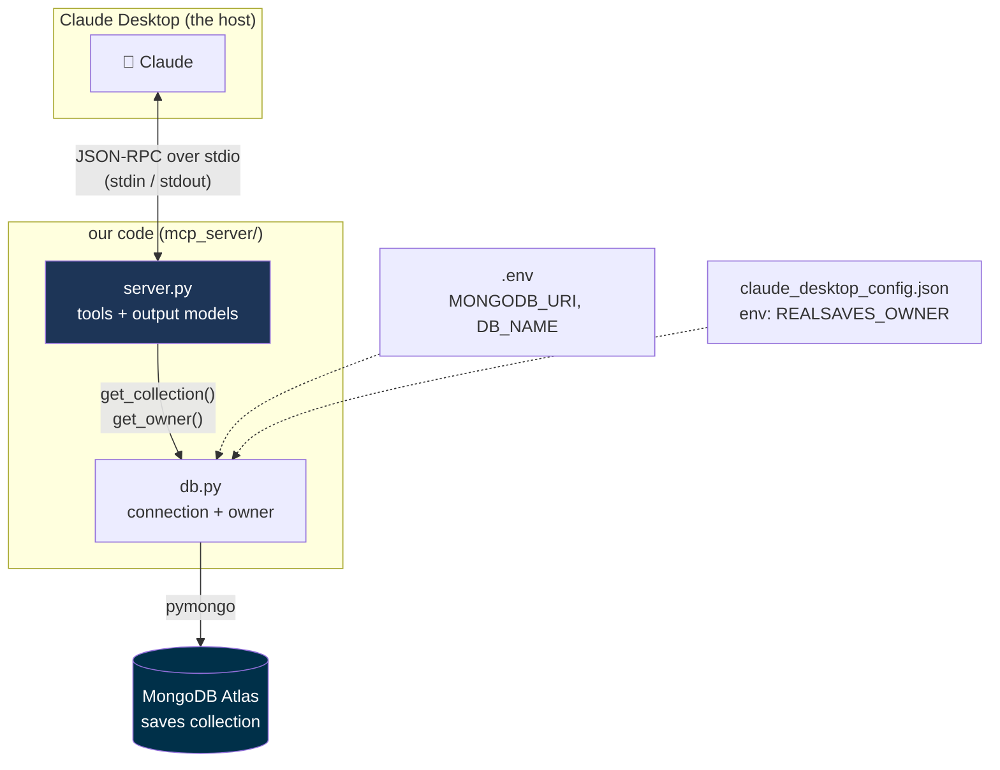
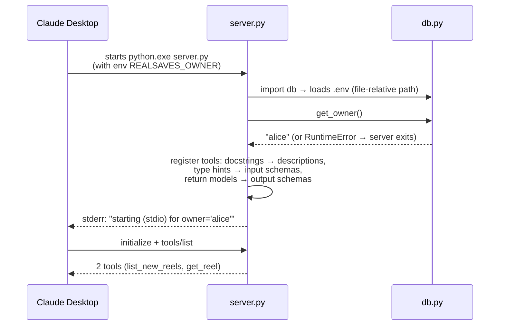
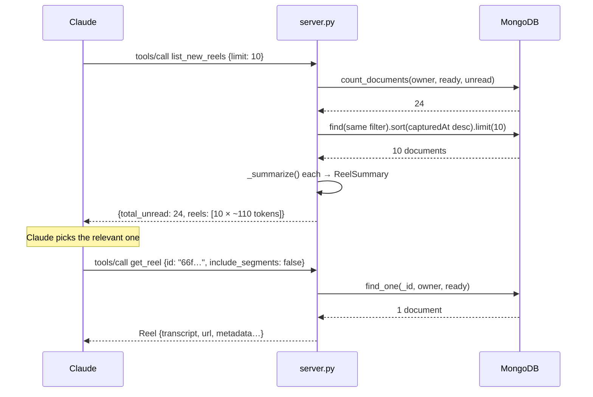
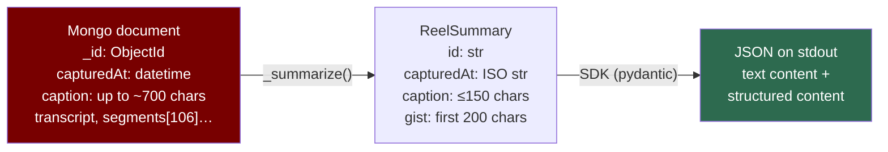
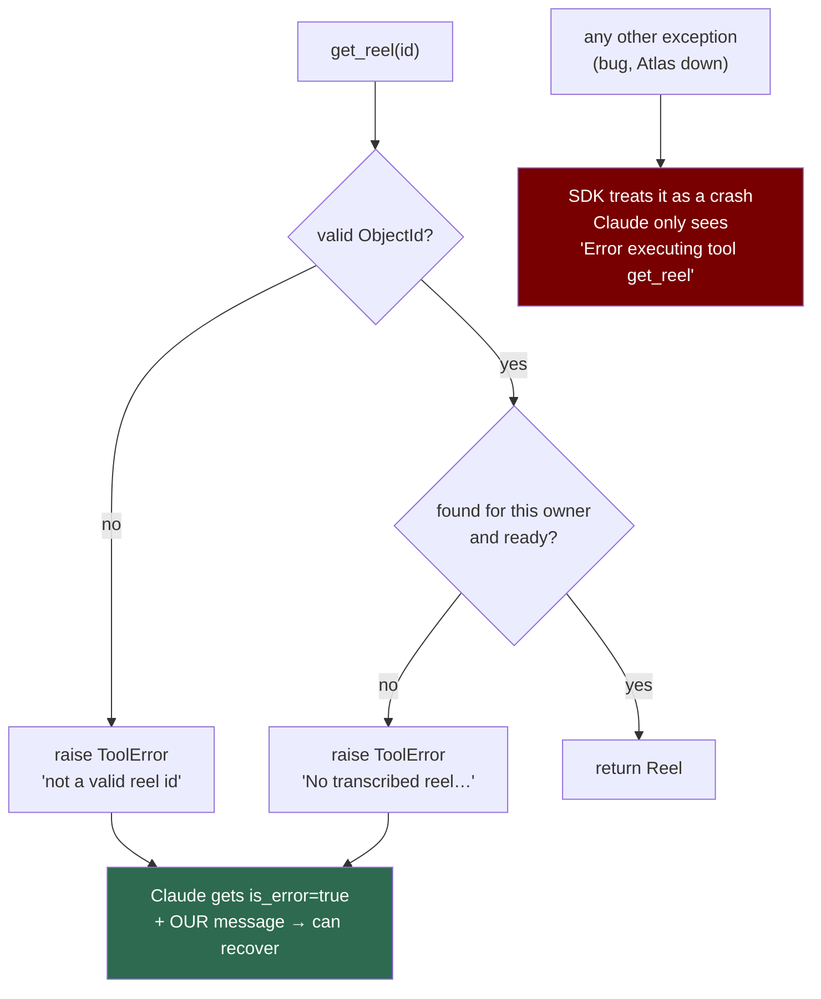

# The MCP Server, Explained (with diagrams)

A visual companion for reading the code. Pair it with [`server.py`](server.py) and
[`db.py`](db.py). For the concepts (what MCP is, tools vs resources, pull vs push) see
[`../PHASE3-EXPLAINED.md`](../PHASE3-EXPLAINED.md).

> Mental model: the server is a **librarian at a desk**. Claude walks up with a request slip
> (`tools/call`). The librarian checks the catalogue (MongoDB), and answers in one of two
> ways: a **short list of index cards** (`list_new_reels`) or **one whole book**
> (`get_reel`). The librarian never leaves the desk and never starts a conversation.

---

## 1. The file map — who calls whom



**Read it as:** Claude only ever talks to `server.py`. `server.py` only asks `db.py` for two
things (the collection and the owner). Settings come from two places: the database address
from `.env` (shared with the API and worker), and **whose reels** from the Claude Desktop
config (it belongs to the client connection).

---

## 2. Startup — what happens when Claude Desktop launches



Note: **the Mongo connection is lazy.** Nothing talks to Atlas until the first tool call
(`get_collection()` opens the client then, and keeps it for the server's life).

---

## 3. One conversation — list, then detail



**The pattern:** the list is cheap (~1,100 tokens for 10 reels), the detail is expensive
(a full transcript), and Claude only pays for detail when it needs it.

---

## 4. How the data changes shape



Three conversions to notice in the code:

| Mongo gives | JSON needs | Where |
|---|---|---|
| `ObjectId("66f…")` | `"66f…"` (string) | `str(doc["_id"])` |
| `datetime` | ISO string | `_iso()` |
| a long caption with newlines | one short line | `_truncate()` |
| `caption` (or only `title` on rows saved before the caption fix) | the best caption available | `_caption()` |

### Why pydantic models, not plain dicts

Because the tools return `ReelList` / `Reel` models, the SDK:
1. publishes an **output schema** for each tool (Claude and programs know the exact shape), and
2. sends **structured content** (clean JSON) next to the text version.

The `Field(description=...)` texts end up in those schemas: they document the data *for Claude*.

---

## 5. Input schemas — from type hints

```
Python:  limit: Annotated[int, Field(ge=1, le=50, description="How many reels to return")] = 10
                     │
                     ▼  (pydantic)
JSON:    "limit": {"type": "integer", "minimum": 1, "maximum": 50,
                   "default": 10, "description": "How many reels to return"}
```

`ge`/`le` mean the SDK **rejects** `limit: 500` before our code even runs. Validation for free.

---

## 6. The error paths



**Key idea (SDK v2):** `ToolError` = *"a failure I saw coming"*: Claude reads our exact
message and can fix its call (e.g. use an id from the list). Any other exception = *crash*:
the details are hidden from Claude on purpose (they could leak internals) and logged to
stderr with a traceback. The server keeps running either way.

**Owner safety:** every query filters by `owner`, so another user's reel id behaves exactly
like a non-existent one ("not found"), and nothing leaks.

---

## 7. Quick function reference

| File | Function | Takes in | Gives back |
|---|---|---|---|
| db.py | `get_owner()` | — (env `REALSAVES_OWNER`) | owner string, or raises |
| db.py | `get_collection()` | — (reads .env) | the `saves` collection (cached client) |
| server.py | `list_new_reels(limit)` | 1–50 | `ReelList {total_unread, reels}` |
| server.py | `get_reel(id, include_segments)` | reel id + flag | `Reel` (or `ToolError`) |
| server.py | `_summarize(doc)` | a Mongo document | `ReelSummary` |
| server.py | `_truncate(text, n)` / `_iso(v)` | text / datetime | short one-liner / ISO string |
| server.py | `log(msg)` | a message | — (writes to **stderr**) |

> Tip while reading the code: start at the bottom (`if __name__ == "__main__"`), then read
> the two `@mcp.tool` functions. The models above them are just the *shapes* those tools return.
