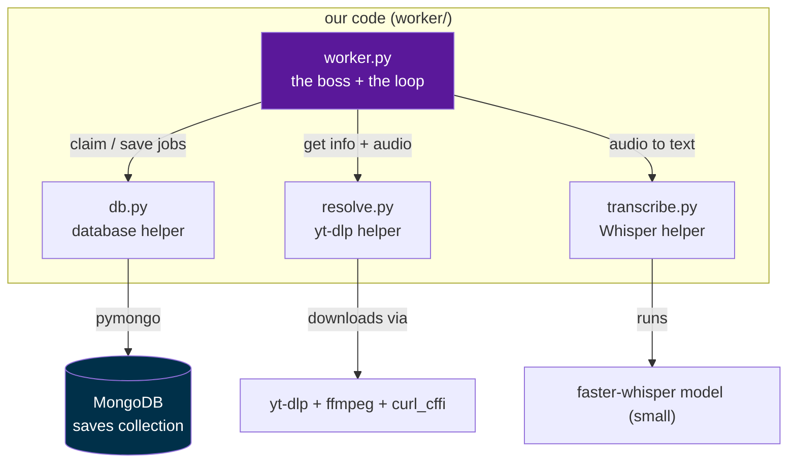
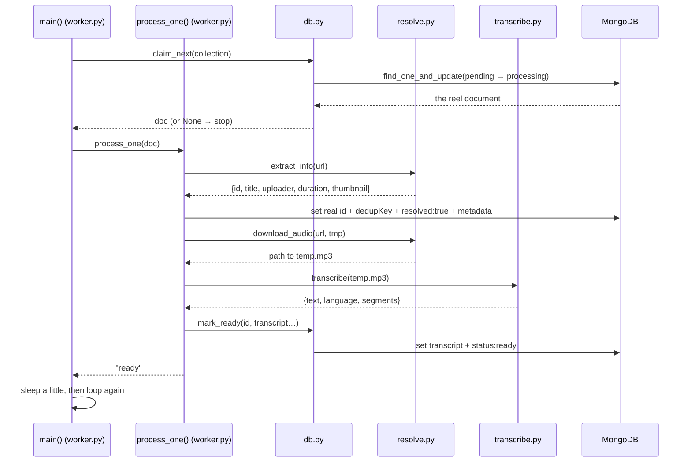
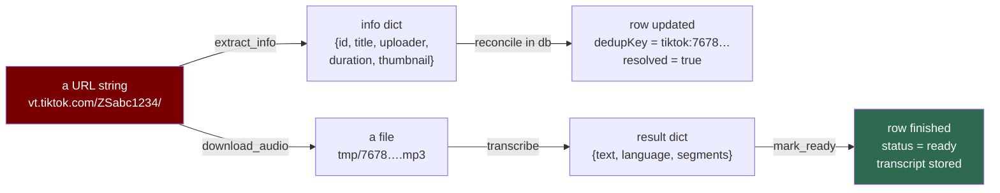
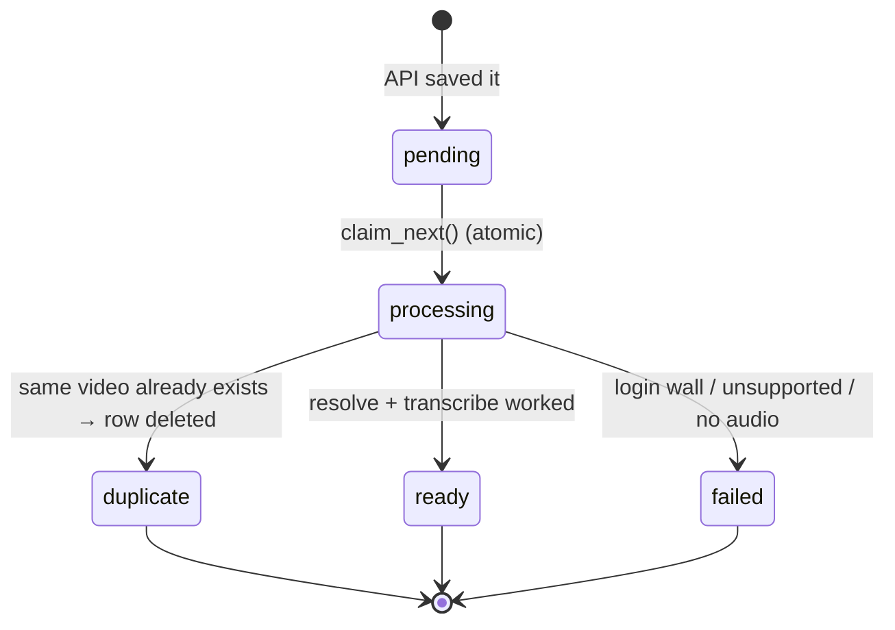
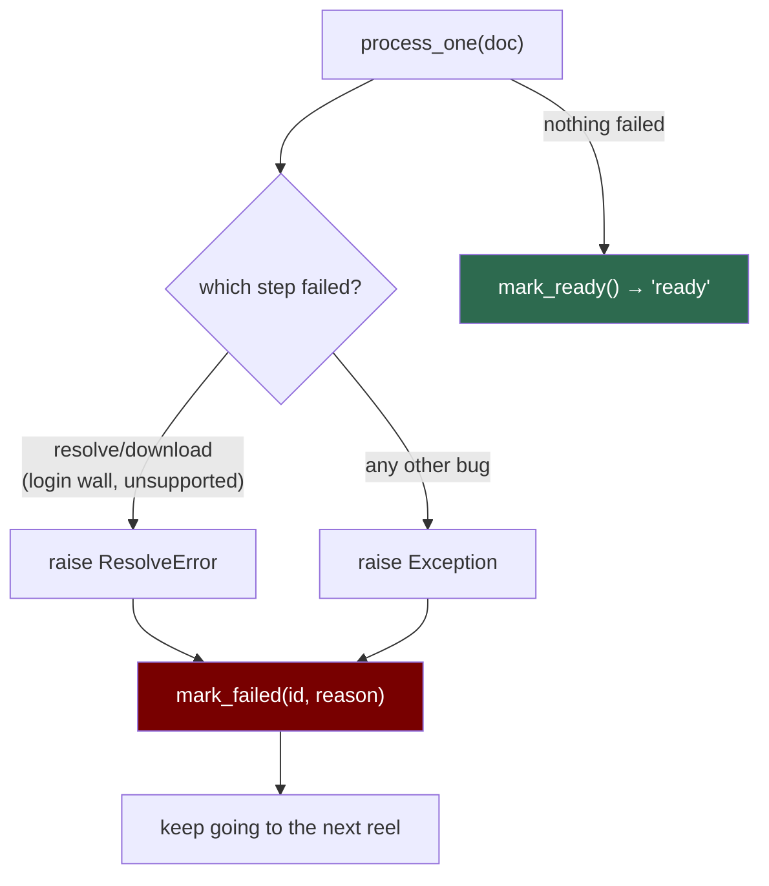

# The Worker, Explained (with diagrams)

A visual companion for reading the code. It shows **how data flows from file to file and
from function to function**. Pair it with [`worker.py`](worker.py), [`db.py`](db.py),
[`resolve.py`](resolve.py), [`transcribe.py`](transcribe.py).

> Mental model: the worker is a small kitchen. `worker.py` is the boss who reads the order
> ticket, then walks it to three stations — **db** (storage), **resolve** (fetch), and
> **transcribe** (AI) — and finally writes the finished dish back to storage.

---

## 1. The file map — who calls whom

Only `worker.py` knows the whole story. The other three files are helpers it calls; each
talks to one outside thing (MongoDB, yt-dlp, Whisper).



**Read it as:** `worker.py` depends on the three helpers; the helpers depend on the outside
tools. Nothing points *back* at `worker.py` — data flows one direction, which keeps it simple.

---

## 2. One full run — the sequence (happy path)

This is what happens for **one** reel, from claim to `ready`. Each arrow is a function call;
the note on the way back is what it returns.



**The loop:** `main()` keeps calling `claim_next()`. As long as it returns a reel, it runs
`process_one()`. When `claim_next()` returns `None` (queue empty), the loop ends and prints
the summary.

---

## 3. How the data changes shape at each hop

This is the part that helps most when reading line by line: **the data is transformed step
by step.** A short link becomes rich metadata, then an audio file, then text.



### The exact shapes (match these to the code)

**A claimed `doc`** (what `claim_next` returns — a row from MongoDB):
```
{ _id, owner, platform, contentId, dedupKey, resolved, url, rawUrl,
  note, status:"processing", attempts, capturedAt, transcript:null }
```

**What `extract_info(url)` returns** (built by `_summarize` in resolve.py):
```
{ id, platform, webpageUrl, title, caption, uploader, durationSec, thumbnailUrl }
```
`caption` = yt-dlp's `description` (the real post caption on every platform); `title` is
kept but is a placeholder on Instagram. `durationSec` is `None` for Instagram.

**What `transcribe(path)` returns:**
```
{ text: "the whole transcript…",
  language: "en",           # auto-detected
  duration: 29.4,           # audio length in seconds, measured by Whisper
  segments: [ {start, end, text}, … ] }   # timestamped lines
```

**What `mark_ready` writes onto the row:**
```
{ transcript, transcriptLang, segments, status:"ready", processedAt, error:null
  [, durationSec]   # only when the platform gave none → from transcribe()'s duration
}
```

---

## 4. The status state machine (a row's life)

Every reel is a row that moves through these states. The worker only ever picks up
`pending` rows.



- **`processing`** is a short-lived "someone is working on this" flag. It's what makes the
  claim *atomic* — two runs can never grab the same row.
- **`duplicate`** isn't stored as a status; it means the row was **merged and deleted**
  because another row already had the real id (same video shared via two codes).

---

## 5. The error paths (what happens when a step fails)

The boss wraps each reel in a safety net so one bad link never crashes the whole run.



Key idea: **failures are expected, not exceptional.** A Facebook photo post, a private
video, or the fake test link all end as `failed` with a readable reason in the `error`
field — and the worker moves on.

---

## 6. Quick function reference

| File | Function | Takes in | Gives back |
|---|---|---|---|
| db.py | `get_collection()` | — (reads .env) | the `saves` collection |
| db.py | `claim_next(col)` | the collection | one reel (now `processing`) or `None` |
| db.py | `mark_ready(col, id, fields)` | id + transcript/metadata | — (writes to DB) |
| db.py | `mark_failed(col, id, error)` | id + reason | — (writes to DB) |
| resolve.py | `extract_info(url)` | a link | info dict (no download) |
| resolve.py | `download_audio(url, dir)` | a link + temp folder | path to an `.mp3` |
| transcribe.py | `get_model(size)` | model size | loaded Whisper model (cached) |
| transcribe.py | `transcribe(path, …)` | an mp3 path | `{text, language, duration, segments}` |
| backfill.py | `backfill_one(col, doc, tmp)` | one `ready` row | the `caption` / `durationSec` it added |
| worker.py | `process_one(col, doc, …)` | one claimed reel | `"ready"` / `"duplicate"` (or raises) |
| worker.py | `main()` | CLI options | — (runs the loop, prints summary) |

> Tip while reading the code: start at `main()` in [`worker.py`](worker.py), follow it into
> `process_one()`, and every time you see `resolve.`, `transcribe.`, or `db.`, jump to that
> file. That call order **is** the data flow in diagram 2.
